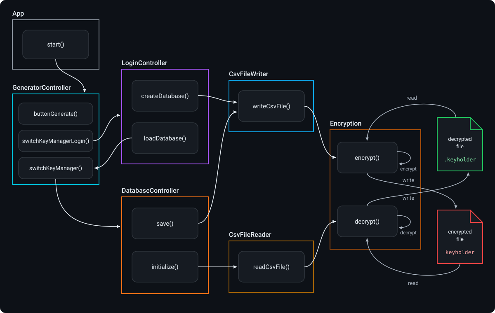

# KeyNest 🔑 & 🔒
    
KeyGenerator and KeyManager combined!  
Generate secure passwords and store them in an offline encrypted file! 

**Features  ✨**
---------
- Customizable Password Length
- **Configurable Character Types**:  
  - Special characters (e.g., `@`, `#`, `!`)  
  - Uppercase letters (e.g., `A`, `B`, `C`)  
  - Lowercase letters (e.g., `a`, `b`, `c`)  
  - Digits (e.g., `0-9`)

- **Offline Encrypted Vault**: Stores credentials locally in an AES-encrypted database file (`~/keyholder`).
- **Master Password Protection**: Derives a 128-bit AES key from the user's master password via `SHA-256`.
- **Full CRUD Management**: Add, edit, sort, and remove saved accounts with toggleable password visibility.

**Specification ⚙️**
--------
- Cryptographically strong password generation using `SecureRandom`
- SHA-256 message digest for master key derivation `SecretKeySpec`
- GUI developed with JavaFX SceneBuilder
- AES for vault encryption
- CSV database format
- Maven support for dependencies and automation

**Screenshots 🖼️**
---------

Generator/Main view | KeyManager login view
:-------------------------:|:-------------------------:
  |  

KeyManager view (passwords hidden) | KeyManager view (passwords shown)
:-------------------------:|:-------------------------:
  |  

---

## 🔄 Flow Diagram

---
