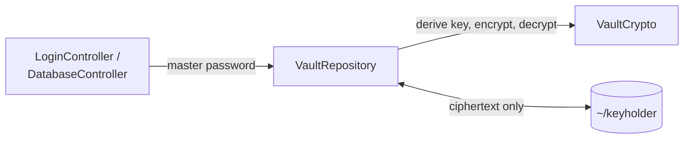

# KeyNest 🔑

[](https://github.com/sersah/KeyNest/actions/workflows/ci.yml)


A desktop app that **generates strong passwords** and **stores them in an offline, encrypted vault** protected by one master password. Built with Java 21 and JavaFX.

Generator | Vault login
:-------------------------:|:-------------------------:
 | 

Vault (passwords hidden) | Vault (passwords shown)
:-------------------------:|:-------------------------:
 | 

## Features

**Password generator**
- 4 to 99 characters, any mix of uppercase, lowercase, digits and special characters
- At least one character from every selected group
- Uses `SecureRandom`
- Strength shown in bits of entropy
- Copy button; the clipboard is cleared again after 30 seconds

**Encrypted vault**
- Everything is stored locally in one encrypted file (`~/keyholder`), nothing goes over the network
- Master password is never stored, and must be at least 8 characters
- Add, edit and remove accounts, passwords are hidden until you show them

## Getting started

You need **JDK 21 or newer**. Maven doesn't have to be installed, the Maven Wrapper downloads it.

```bash
git clone https://github.com/sersah/KeyNest.git
cd KeyNest
./mvnw javafx:run        # Windows: mvnw.cmd javafx:run
```

Run the tests with `./mvnw test`.

## Security design

**Key derivation.** The master password is turned into a 256-bit AES key with **PBKDF2-HMAC-SHA256** and 600,000 iterations (the current OWASP recommendation). Every vault gets its own random 16-byte salt, so the same password gives a different key for every vault and precomputed tables don't help an attacker. The iterations make each guess slow: unlocking takes a fraction of a second for me, but brute forcing millions of passwords gets expensive.

**Encryption.** The vault content is encrypted with **AES-256-GCM**. Every save uses a new random 12-byte IV. GCM also adds an authentication tag, which gives two things for free:
- a wrong master password is detected reliably (the tag doesn't match), instead of decrypting to garbage
- if someone changes even one bit of the file, decryption fails instead of loading manipulated data

**File format**

```
| "KNST" (4) | version (1) | salt (16) | IV (12) | ciphertext + GCM tag (16) |
```

The header (magic, version, salt) is passed to GCM as *additional authenticated data*. It isn't encrypted, but changing it also breaks the tag. The version byte means the format can be changed later without breaking old vaults.

**Decrypted data stays in memory:** The CSV is built and parsed in memory (`StringWriter` / `StringReader`), and only the ciphertext is written to disk. Saving writes to a temporary file first and then atomically replaces the vault, so a crash in the middle of a save can't corrupt it. On Linux/macOS the file is only readable by the owner (`rw-------`).

**Master password handling:** The password is kept as a `char[]` and overwritten with zeros right after the key is derived. While the vault is open, the app only keeps the derived key, not the password.

**Unlocking file:** read the file → take the salt from the header → derive the key → decrypt. Only if that works is the vault view opened. A wrong password keeps you on the login screen.

### What changed compared to the first version

- first version used AES in **ECB mode** with a key that was just `SHA-256(password)` cut to 128 bits. ECB encrypts identical blocks to identical ciphertext, so patterns in the data stay visible. 
- There was no salt, almost no cost per password guess, and no integrity check. Because of that, a wrong password used to open an empty vault, and the next save overwrote the real one. It also wrote the decrypted vault to a temporary plaintext file. All of this is fixed now.

## Limitations

This is a learning project, not a replacement for KeePassXC or Bitwarden. Things it doesn't protect against or doesn't do yet:

- **Malware on the same computer.** A keylogger or something that reads memory gets your password; no password manager can fully stop that.
- **Strings in memory.** JavaFX text fields and the account data are Java `String`s, which can't be wiped, so they stay in memory until the garbage collector removes them.
- **No auto-lock.** The vault stays open until you close the app.
- **PBKDF2 instead of Argon2id.** Argon2id is memory-hard and better against GPU attacks, but isn't in the JDK, so it would need an extra library.
- **No backups or sync.** If you delete `~/keyholder` or forget the master password, the data is gone.
- Key derivation runs on the UI thread, so the window freezes for a moment when unlocking.

## Architecture

```
io.github.sersah.keynest
├── App                     JavaFX entry point
├── GeneratorController     generator view + switching between views
├── LoginController         create / unlock the vault
├── DatabaseController      vault table: add, edit, remove, show passwords
├── Dialogs                 shared modal dialogs
├── generator/
│   └── PasswordGenerator   password generation + strength (no JavaFX, unit tested)
├── vault/
│   ├── VaultCrypto         PBKDF2 key derivation, AES-GCM encrypt/decrypt, file format
│   ├── VaultRepository     reads/writes the encrypted file, CSV (de)serialisation
│   ├── VaultKey            derived key + salt
│   ├── VaultSession        an unlocked vault
│   ├── Account             one entry (record)
│   └── WrongPasswordException
└── popups/                 input dialogs (account form, master password, confirm remove)
```

The `vault` and `generator` packages don't use JavaFX at all, which is why they can be tested with plain JUnit.



## Tech stack

Java 21 · JavaFX 21 (FXML, Scene Builder, CSS) · Apache Commons CSV · JUnit 5 · Maven · GitHub Actions
