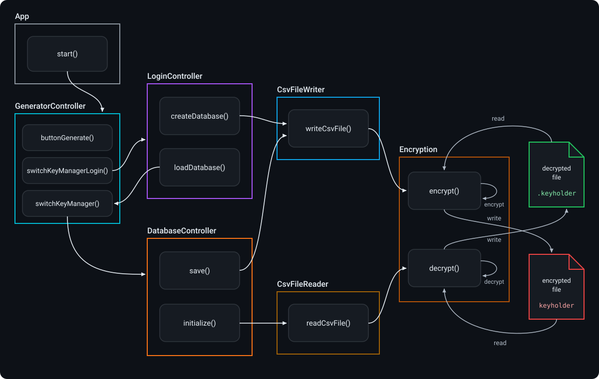

# KeyNest 🔑

[](https://github.com/sersah/KeyNest/actions/workflows/ci.yml)


A desktop app that **generates strong passwords** and **stores them in an offline, encrypted vault** protected by a single master password. Built with Java 21 and JavaFX.

Generator | Vault login
:-------------------------:|:-------------------------:
 | 

Vault (passwords hidden) | Vault (passwords shown)
:-------------------------:|:-------------------------:
 | 

## Features

**Password generator**
- Length from 4 to 99 characters
- Choose any mix of uppercase, lowercase, digits and special characters
- Uses `java.security.SecureRandom`
- Strength indicator and one-click copy to clipboard

**Encrypted vault**
- Stored locally in a single encrypted file (`~/keyholder`), no network access
- Protected by a master password that is never stored
- Add, edit and remove accounts; passwords are hidden until you toggle them visible

## Getting started

**Requirements:** JDK 21 or newer. Maven is not needed; the Maven Wrapper downloads it.

```bash
git clone https://github.com/sersah/KeyNest.git
cd KeyNest
./mvnw javafx:run        # Windows: mvnw.cmd javafx:run
```

## Security design

<!-- TODO(Serhat): write this section in your own words. Cover:
     - how the key is derived from the master password (algorithm, iterations, salt)
     - which cipher/mode is used and why (and why ECB was replaced)
     - what the encrypted file contains (salt | iv | ciphertext)
     - how a wrong master password is detected
     - where decrypted data lives while the app is open -->

## Architecture

```
io.github.sersah.keynest
├── App                    JavaFX entry point, loads GUImain.fxml
├── GeneratorController    password generator view + navigation
├── LoginController        create / unlock the vault
├── DatabaseController     vault table: add, edit, remove, show passwords
├── Encryption             key derivation + AES-GCM encrypt/decrypt
├── CsvFileReader/Writer   (de)serialise accounts as CSV
├── Account                one vault entry (name, email, password)
├── Dialogs                shared modal dialogs
└── popups/                input dialogs (add/edit/remove account, master password)
```



## Running the tests

```bash
./mvnw test
```

## Limitations and future work

<!-- TODO(Serhat): be honest about what this does NOT protect against, e.g.
     clipboard is not cleared automatically, Java Strings can't be wiped from memory,
     no protection against malware on the same machine, possible next steps
     (Argon2, auto-lock after inactivity, clipboard timeout, ...). -->

## Tech stack

Java 21 · JavaFX 21 (FXML, Scene Builder, CSS) · Apache Commons CSV · JUnit 5 · Maven · GitHub Actions
